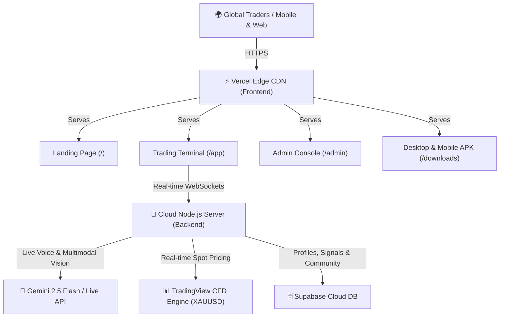

# 🦈 SHARK QUANT AI - Institutional Trading & Macro SMC Platform

> **Wall Street Quant Intelligence, Smart Money Concepts (SMC), and AI-Powered Live Voice Execution.**

---

## 🚀 Live Cloud Architecture

---

## 🛠️ Instant Deployment Guide

### 1️⃣ Deploy Frontend on Vercel (1-Click)
1. Import this repository `bithomreco-lang/shark-quant` into [Vercel](https://vercel.com).
2. Framework Preset: **Other**
3. Root Directory: `./` (leave default)
4. Build Command: Leave blank (pre-built production bundle)
5. Output Directory: Leave blank
6. Click **Deploy**! 🚀
   - Landing Page will be at: `https://your-domain.vercel.app/`
   - Trading Terminal will be at: `https://your-domain.vercel.app/app`
   - Admin Panel will be at: `https://your-domain.vercel.app/admin` (Passcode: `amine123123@`)
   - Windows & Android Downloads at: `https://your-domain.vercel.app/downloads`

---

### 2️⃣ Deploy Backend & Live Voice Engine (Render / Railway)
Because Gemini Live requires persistent **WebSockets** (`/live`), deploy the `backend/` folder on [Render.com](https://render.com) or [Railway.app](https://railway.app):
1. Create a **New Web Service** from this GitHub repo.
2. Root Directory: `backend`
3. Runtime: **Node** (or use the included `backend/Dockerfile`)
4. Build Command: `npm install`
5. Start Command: `node server.js`
6. Add Environment Variables:
   - `GEMINI_API_KEY`: Your Google Gemini API Key
   - `SUPABASE_URL`: Your Supabase Project URL
   - `SUPABASE_KEY`: Your Supabase Service Role Key
   - `PORT`: `5000` (or leave default assigned by host)

---

## 🔐 Credentials & Access

- **Admin Passcode:** `amine123123@`
- **Default Port (Local):** `5000`

---

## 📦 Project Structure

- `/` - High-converting Glassmorphism Landing Page & Vercel configuration (`vercel.json`)
- `/app` - Web Trading App (React Native for Web)
- `/admin` - Shark Quant Admin Control Center
- `/downloads` - Real Windows Desktop Launcher & Android packages
- `/backend` - Node.js Express server, TradingView scanner, Gemini Live WebSockets & Supabase sync
- `/src_mobile_app` - React Native Expo source code

---

*Built with passion for high-frequency institutional traders & algorithmic scalpers.*
